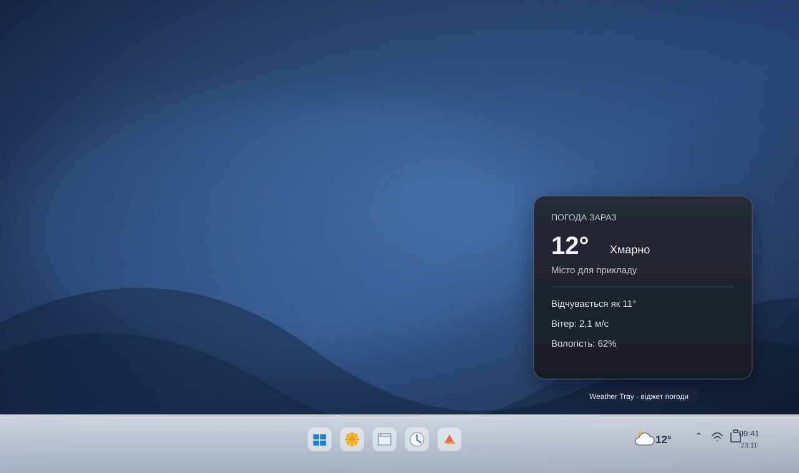

# Weather Tray

Віджет показує поточну погоду на панелі завдань Windows 11, поруч із системним треєм. Підказка містить опис погоди, місто, відчувається як, вітер і вологість.

_Ілюстрація інтерфейсу з демонстраційними даними; це не скриншот запущеної програми._

**Завантажити:** [WeatherTray.exe для Windows 11 x64](https://github.com/makser008-bit/WeatherTray/releases/download/v0.4.4/WeatherTray.exe) · [Усі файли релізу v0.4.4](https://github.com/makser008-bit/WeatherTray/releases/tag/v0.4.4)

Документація: [українською](README.txt) · [English](README_EN.txt)

---

The widget displays current weather on the Windows 11 taskbar, beside the system tray. Its tooltip includes conditions, city, feels-like temperature, wind, and humidity.